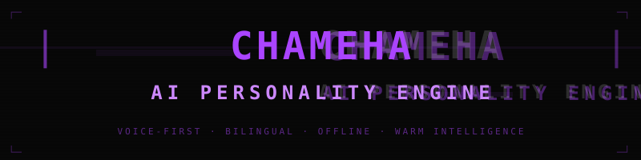
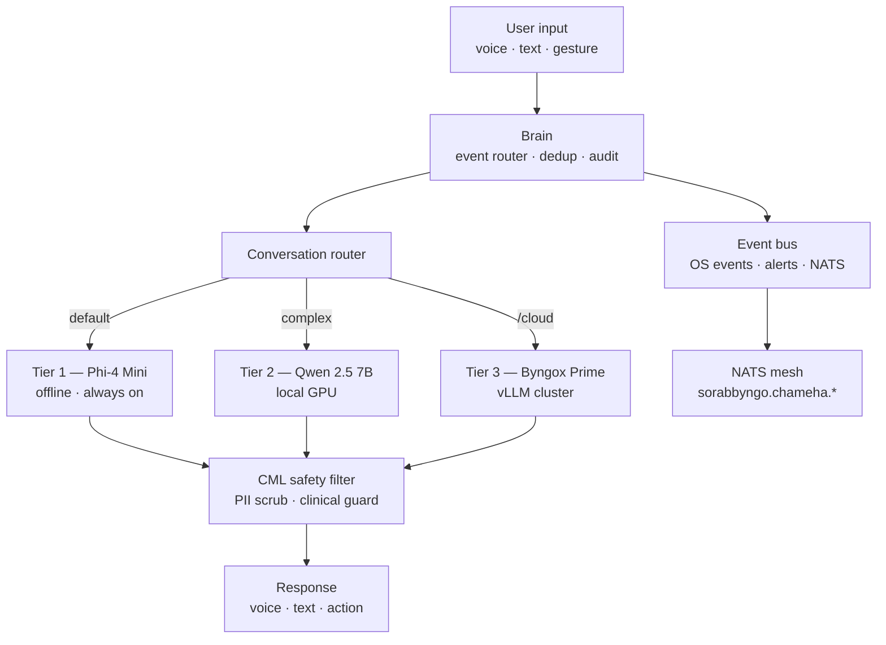

<p align="center">
  
</p>
<p align="center">
  <strong>Chameha — AI Personality and Interface Engine</strong><br/>
  The face of SORABBYNGO OS
</p>
<p align="center">
  
  
  
  
</p>

---

Chameha is the voice, face, and personality of SORABBYNGO OS. It boots directly to a voice shell — no lock screen, no launcher. The AI is the interface. Warm, intelligent, bilingual English/Swahili, and always offline-first.

> *"Welcome. This is Sorabbyngo."*

---

## Architecture



---

## Components

| Module | Role |
|---|---|
| `brain.py` | Event router — dedup, audit, priority, UI callbacks |
| `conversation.py` | Tier routing — T1 default, T3 `/cloud` only |
| `tier1.py` | Phi-4 Mini + Aya 23 — offline, always on |
| `tier2.py` | Qwen 2.5 7B — local GPU, complex queries |
| `tier3.py` | Byngox Prime — vLLM cluster |
| `personality/tone_engine.py` | Tone adaptation per context |
| `personality/language_detect.py` | Swahili / Hausa / Yoruba detection |
| `interfaces/voice_interface.py` | Whisper STT + Coqui TTS |
| `interfaces/chat_interface.py` | Text shell |
| `event_bus.py` | Threaded priority event bus |
| `identity.py` | NodeID hardware seal |
| `nats_listener.py` | Listens to OS security + health events |

---

## Tier routing

| Tier | Model | When | Latency |
|---|:---:|---|---|
| 1 | Phi-4 Mini · Aya 23 | Default — all queries | < 2s |
| 2 | Qwen 2.5 7B | Complex reasoning | 3–8s |
| 3 | DeepSeek-R1 70B | `/cloud <query>` explicit only | 8–30s |

---

## Quick start

```bash
# Monitor-only dev mode
python3 main.py --mode=chat

# Voice mode (requires Whisper + Coqui)
python3 main.py --mode=voice

# Run tests
pytest tests/ -v
```

---

## Part of SORABBYNGO OS

| Repo | Role |
|---|---|
| [byngox](https://github.com/sorabbyngo-os/byngox) | AI reasoning engine |
| [cml](https://github.com/sorabbyngo-os/cml) | Safety and audit layer |
| [byngonet](https://github.com/sorabbyngo-os/byngonet) | Mesh network |
| [sorabbyngo-os](https://github.com/sorabbyngo-os/sorabbyngo-os) | Kernel |

---

<p align="center">
  <strong>Sorabbyngo Company</strong> &nbsp;·&nbsp; Kisii, Kenya &nbsp;·&nbsp; 2026<br/>
  <em>Rhythm of Digital Life</em>
</p>
